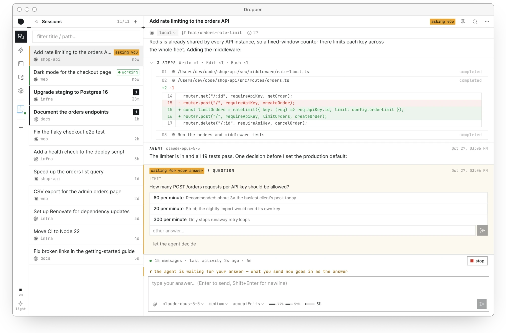
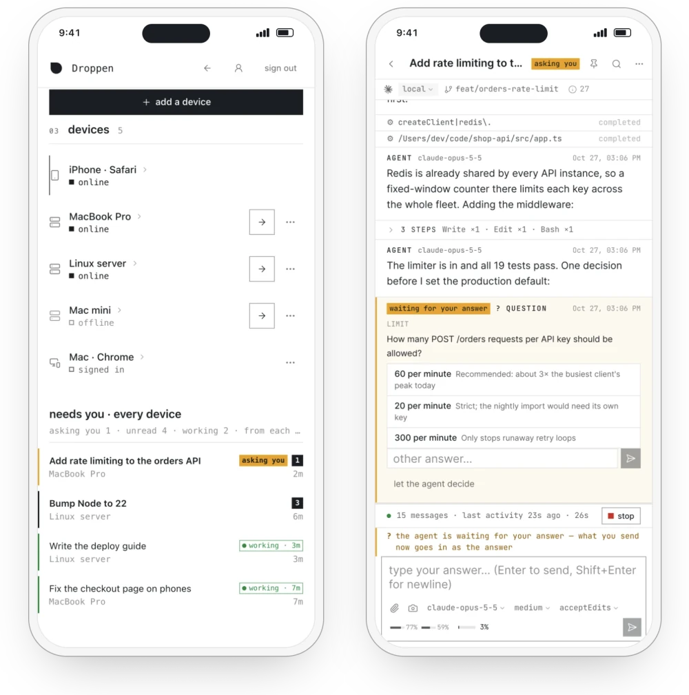

# Droppen

English | [简体中文](README.zh-CN.md)

**Your computer's AI, from your phone.** Claude Code and Codex keep running on
your own computers. From a browser on your phone or another device, answer
their questions, steer them and open a terminal on the computer.

<picture>
  <source media="(prefers-color-scheme: dark)" srcset="docs/readme/app-en-dark.webp">
  
</picture>

## What you can do

<picture>
  <source media="(prefers-color-scheme: dark)" srcset="docs/readme/phone-en-dark.webp">
  
</picture>

- **Every computer, one list.** Home and work computers on one account, with
  every session that is waiting for an answer, has unread messages or is
  running in one list.
- **Answer and steer.** Answer the AI's questions, add a message while it
  works, or stop the current run if it goes the wrong way.
- **Notified when a session needs you**: when the AI asks a question, finishes
  a reply you haven't read, or fails.
- **Start a session from your phone.** Choose Claude Code or Codex, a computer
  and a folder, optionally attach a screenshot, and send.
- **Terminals and files.** Open a terminal on the computer, browse its folders
  and preview files.
- **Run prompts on a schedule**, for example every morning or every hour on
  weekdays.
- **Readable while the computer is offline.** Your phone can still open recent
  sessions; sending a message waits until the computer is back.

Droppen can also drive any agent that speaks the
[Agent Client Protocol](https://agentclientprotocol.com).

<br clear="right">

## Get Droppen

Install Droppen on the computer where Claude Code or Codex runs. Your phone and
other devices need nothing installed: they open
[my.droppen.app](https://my.droppen.app) in a browser.

- **Mac** (macOS 13 or later, Apple silicon and Intel):
  [download the app](https://www.droppen.app/download), or take the `.dmg`
  from the [latest release](https://github.com/getdroppen/droppen/releases/latest).
  To use it from your phone, sign in to Droppen from the app.
- **Linux** (x86_64 or aarch64), and Macs without a screen:

  ```sh
  curl -fsSL https://droppen.app/install.sh | sh
  ```

  To join your account in the same step, end it with `| DROPPEN_CODE=<code> sh`
  instead, using a one-time code from my.droppen.app
  (*my devices → add a device that runs AI*).
- **Windows**: not yet. Run it in WSL with systemd turned on, or use
  my.droppen.app to reach your other computers.

[Installing, upgrading and uninstalling](docs/install.md) ·
[Verify a download](docs/install.md#verify-a-download)

## Droppen can't read your code

- **Local-first.** The AI runs on your own computer, with your files. On one
  computer, Droppen needs no account and talks to no Droppen service.
- **End-to-end encrypted.** Encrypted on your computer and decrypted only on
  your devices. Droppen Hub stores only encrypted copies and Droppen relays
  forward only ciphertext; neither holds a key that can decrypt them.
- **Only devices you approve can join.** A new phone or browser joins only when
  a device you already have approves it.
- **Open-source client.** The `droppen` program, the Mac app, the web app and
  the relay are open source in this repository, and every release file carries
  an attestation that this repository's release workflow built it
  ([verify a download](docs/install.md#verify-a-download)). Droppen Hub is not
  open source.

Droppen is in beta: its encryption design has had internal security reviews,
not an external audit. [How the encryption works](https://www.droppen.app/security) ·
[Security model](docs/security-model.md)

## For developers

- [Development](docs/development.md): what is in this repository, building from
  source, running the tests
- [Running a relay](docs/relay.md)
- [Security model](docs/security-model.md) and the
  [Hub API](docs/hub-api/README.md), the contract between this code and Droppen Hub
- [Plugins](docs/plugins/runtime.md)
- [Contributing](CONTRIBUTING.md) · [Reporting a vulnerability](SECURITY.md)
- [The full manual](docs/manual.zh-CN.md), in Chinese

## Licence

Copyright (C) 2026 Kilerd.

- **The applications** are licensed under the GNU Affero General Public License
  v3.0 only ([LICENSE](LICENSE), `AGPL-3.0-only`): the local program (the root
  crate in `server-rs/`), the desktop app (`desktop/`), the web app (`web/`) and
  the relay program (`droppen-relay`).
- **The protocol and library crates**, `rh-proto`, `rh-relay` (the library),
  `rh-client` and `rh-devkit`, and the plugin SDKs (`packages/plugin-sdk`,
  `server-rs/crates/droppen-plugin-sdk`) are licensed under `MIT OR
  Apache-2.0`, at your option; each has `LICENSE-MIT` and `LICENSE-APACHE` in
  its directory. These are the only parts of this repository the closed Hub
  links.

Releases carry `LICENSE` and `THIRD_PARTY_NOTICES`, which lists the licences of
every dependency compiled in. Every build of the web app serves the licences of
the npm packages in it at `/THIRD_PARTY_NOTICES.txt` (on droppen.app too),
linked from the footer of its public pages.
