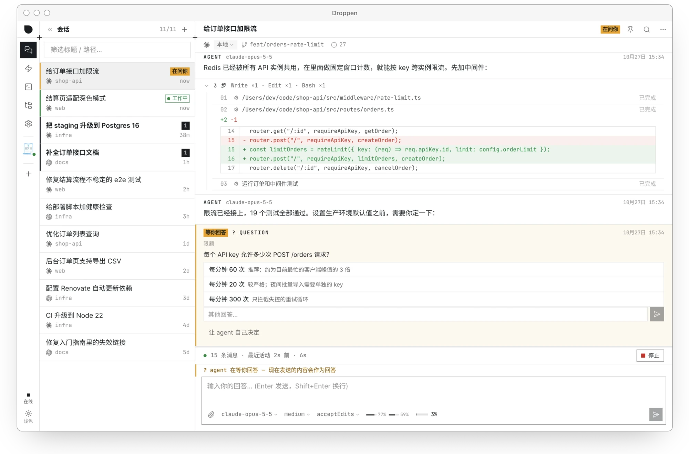
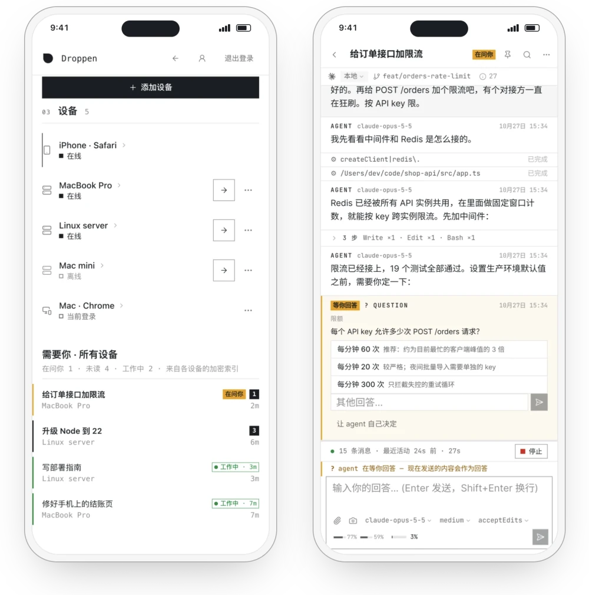

# Droppen

[English](README.md) | 简体中文

**电脑上的 AI，手机上接着用。** Claude Code 和 Codex 仍在你自己的电脑上运行。在手机或其他设备的浏览器中，回答它们的提问、发送指令、打开电脑上的终端。

<picture>
  <source media="(prefers-color-scheme: dark)" srcset="docs/readme/app-zh-CN-dark.webp">
  
</picture>

## 能做什么

<picture>
  <source media="(prefers-color-scheme: dark)" srcset="docs/readme/phone-zh-CN-dark.webp">
  
</picture>

- **所有电脑，一个列表。** 家里和公司的电脑登录同一个账户，等你回答、有未读消息和正在运行的会话汇总在同一个列表中。
- **回答提问，中途干预。** 回答 AI 的提问，在它运行时追加消息，方向不对时可以停止当前的运行。
- **需要你时，收到通知。** AI 向你提问、回复完成但你尚未查看，或运行失败时，都会通知你。
- **在手机上新建会话。** 选择 Claude Code 或 Codex、电脑和文件夹，可附上截图，然后发送。
- **终端和文件。** 打开电脑上的终端，浏览电脑上的文件夹并预览文件内容。
- **定时任务。** 让一条给 AI 的指令按计划在指定的电脑上自动运行，例如每天早上或工作日每小时。
- **电脑离线时，会话仍可查看。** 手机仍能打开最近的会话；发送消息要等这台电脑重新上线。

Droppen 也能驱动任何支持 [Agent Client Protocol](https://agentclientprotocol.com)（ACP）的 agent。

<br clear="right">

## 安装

把 Droppen 装在运行 Claude Code 或 Codex 的电脑上。手机和其他设备无需安装，在浏览器中打开 [my.droppen.app](https://my.droppen.app) 即可。

- **Mac**（macOS 13 及以上，支持 Apple 芯片和 Intel）：[下载应用](https://www.droppen.app/download)，或从[最新发布](https://github.com/getdroppen/droppen/releases/latest)下载 `.dmg`。要在手机上使用，在应用中登录 Droppen。
- **Linux**（x86_64 或 aarch64），以及没有屏幕的 Mac：

  ```sh
  curl -fsSL https://droppen.app/install.sh | sh
  ```

  想在安装时一并加入账户，把结尾换成 `| DROPPEN_CODE=<注册码> sh`；一次性注册码在 my.droppen.app 的「我的设备 → 添加可运行 AI 的设备」中获取。
- **Windows**：暂不支持。可以在开启了 systemd 的 WSL 中运行，或在浏览器中用 my.droppen.app 使用你的其他电脑。

[安装、升级与卸载](docs/install.md)（英文）· [校验下载的文件](docs/install.md#verify-a-download)（英文）

## 你的代码，Droppen 无法读取

- **本地优先。** AI 在你自己的电脑上运行，使用你自己的文件。只在一台电脑上使用时，无需 Droppen 账户，本机程序也不连接任何 Droppen 服务。
- **端到端加密。** 内容在你的电脑上加密，只在你的设备上解密。Droppen Hub 保存的只是加密副本，Droppen 中继转发的只是加密数据，两者都没有解密所需的密钥。
- **只有你批准的设备才能加入。** 新手机或新浏览器，须经你已有的设备批准才能加入。
- **客户端开源。** `droppen` 命令行程序、Mac 应用、网页应用和中继都在本仓库开源；每个发布文件都附有构建来源证明，可以核实它由本仓库的发布流程构建（[校验方法](docs/install.md#verify-a-download)）。Droppen Hub 不开源。

Droppen 目前是测试版：加密设计经过内部安全评审，尚未进行外部审计。[加密设计说明](https://www.droppen.app/security) · [安全模型](docs/security-model.md)（英文）

## 开发者

- [开发](docs/development.md)（英文）：仓库里有什么、从源码构建、运行测试
- [自己运行中继](docs/relay.md)（英文）
- [安全模型](docs/security-model.md)（英文）与 [Hub API](docs/hub-api/README.md)：本仓库代码与 Droppen Hub 之间的契约
- [插件](docs/plugins/runtime.md)
- [参与贡献](CONTRIBUTING.md) · [报告安全漏洞](SECURITY.md)
- [完整中文手册](docs/manual.zh-CN.md)

## 许可证

Copyright (C) 2026 Kilerd。

- **应用**以 [GNU Affero General Public License v3.0 only](LICENSE)（AGPL-3.0-only）授权：本机程序（`server-rs/` 的根 crate）、桌面 App（`desktop/`）、网页（`web/`）和中继程序 `droppen-relay`。
- **协议与库 crate**——`rh-proto`、`rh-relay`（库）、`rh-client`、`rh-devkit`——以及插件 SDK（`packages/plugin-sdk`、`server-rs/crates/droppen-plugin-sdk`）以 `MIT OR Apache-2.0` 授权，二选一；许可证全文在各自目录的 `LICENSE-MIT` 和 `LICENSE-APACHE` 里。闭源的 Droppen Hub 只链接这一类 crate。

公开发布包附带 `LICENSE` 和 `THIRD_PARTY_NOTICES`，列出编译进去的每个依赖的许可证。网页的每次构建都在 `/THIRD_PARTY_NOTICES.txt` 提供其中 npm 包的许可证（droppen.app 上也是），公开页面的页脚有链接。
