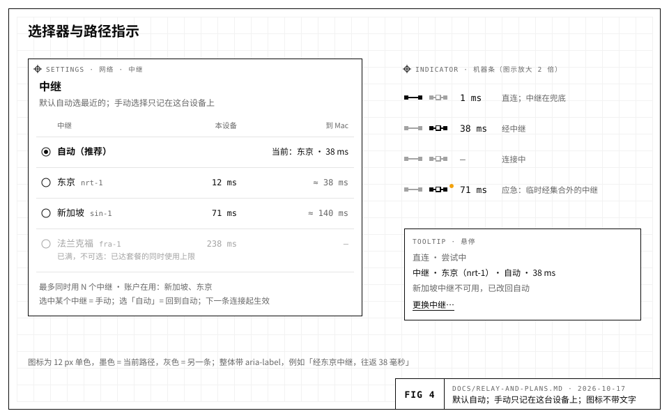

# Droppen 云 M3/M4：拆出中继器、套餐与权益

> 设计稿，2026-10-17。只写设计，不改代码。前提与协议见 `docs/cross-machine-architecture.md`（下称「架构文档」）；代码依据当时的 `main`：Hub、`rh-proto/src/frame.rs`、`server-rs/src/agent/link.rs`、`web/src/lib/{hub,e2e,transport}/`。

> **公开版。** 本文在公开仓库里只保留中继（§2，除 §2.13 的部署选择与成本）和每轮密钥一套流名（§5）。套餐、定价与计费、注册、Hub 的内部实现与运维在 Hub 的私有仓库里；那些节只留标题和一行说明，编号不变，代码注释照旧按「relay-and-plans §n」引用。
>
> **环境变量的名字**（2026-10-20，改名为 Droppen）：中继的变量是 `DROPPEN_RELAY_*`，本文一律写新名字。改名之前叫 `RH_RELAY_*`；新名字没设时中继仍读旧名，每个用到的旧名在启动时记一条 `… is deprecated: rename it …` 警告；两个都设、值不同时用新名字，也记一条。

## 0. 结论

> 本节是中继与套餐两部分的结论，其中套餐、定价与计费是商业内容，不在公开仓库。中继的设计就是 §2。

## 1. 现状与约束

> 本节记的是当时 Hub 的现状与部署约束（Hub 内部），不在公开仓库。

## 2. 中继

### 2.1 什么跑在哪里


| 功能 / 帧 | Hub（控制面，新加坡） | 中继（`droppen-relay`，各处） |
|---|---|---|
| 注册、登录、设备会话、邮箱验证、Turnstile | ✓ | — |
| 设备链 `CHAIN`、证明 `ATTEST` | ✓ | — |
| 信箱、钥环、口令配对会合点、机器注册 | ✓ | — |
| 加密流 `APPEND/ACK/CONFLICT/HEAD/PAGE/CHECKPOINT`、`SUB/RECS/GONE`、`EPHEMERAL`，页的 HTTP | ✓ | — |
| 推送 `PUSH_SEND` | ✓ | — |
| 机器在线态 | ✓（权威：agent 到 Hub 的连接） | 补充：本中继上挂着哪些机器 |
| 套餐、权益、计量汇总、票据签发、中继注册与目录 | ✓ | 上报计量、心跳和健康 |
| 实时通道 `OPEN/DATA/CREDIT/CLOSE`（`rpc`、`mux`、`term`、`blob` 子流和直连信令都在 `DATA` 的密文里） | **不再转发** | ✓ 唯一的转发路径 |
| `PING/PONG` | ✓ | ✓ |

- **中继只接受** `OPEN/DATA/CREDIT/CLOSE/PING/PONG`。类型 ≥ `0x80` 的可忽略帧照旧跳过；其余帧（`CHAIN`、`SUB`、`APPEND`……）一律以 4400「not on a relay」关闭连接。
- **Hub 不再接受通道帧。** `/v1/client` 和 `/v1/agent` 两个 WebSocket 留着，只承载控制和存储。设备在上面发 `OPEN`，Hub 回 `CLOSE {code: 4426, reason: "channels go through a relay"}`。
- **加密流不走中继**：离线副本和新设备回读不在乎几十毫秒，而存储必须集中在一处，才能做 CAS、配额和清扫。会话的**实时视图**本来就走通道里的 `mux`，会跟着通道走中继。
- **附带的好处**：
  - Hub 部署、重启、宕机都不再打断终端；
  - 控制面以后要多副本时，不必再在副本之间转发通道（Hub 原来那套多副本方案只剩在线态和链缓存要处理）；
  - Hub 的出站流量只剩控制和存储。

### 2.2 代码与二进制

- **`crates/rh-relay`**（新 crate，lib + bin `droppen-relay`）：

  | 文件 | 内容 |
  |---|---|
  | `route.rs` | 从 Hub 原来的路由表原样搬来，只改一处：`open()` 的 `allowed` 改由票据的 `peers` 判定 |
  | `conn.rs` | 从 Hub 的连接循环拆出：读写分离、令牌桶、出站预算、心跳 |
  | `ticket.rs` | 验票 |
  | `uplink.rs` | 注册与控制链路（§2.5、§2.10） |
  | `meter.rs` | 每账户字节计数 |
  | `main.rs` | 配置、`keygen`/`deregister` 子命令、优雅停机 |

- **Hub**：不再转发通道（`OPEN/DATA/CREDIT/CLOSE`）。新增注册令牌、中继注册与目录、控制链路 `/v1/relay`、票据签发、设备的中继选择、计量入库。
- **`rh-proto`**：新增 `ticket`（编码、签名、验签，带互通向量）。`sig::LoginRole` 新增 `RelayDevice = 4`、`RelayAgent = 5`、`Relay = 6`。浏览器只签 `RelayDevice`，`web/src/lib/e2e/sig.ts` 同步加上；票据对浏览器是不透明的字节。
- **agent**：
  - 到 Hub 的连接（`link.rs`）不再收 `OPEN`，只做控制和流；
  - 新增 `agent/relays.rs`，管理到各中继的连接，通道的接受与驱动沿用 `link.rs` 的 `accept` 和 `rh_proto::driver`；
  - 路由表按（中继, `ch`）索引。
- **浏览器**：
  - `lib/hub/relays.ts`：目录、测延迟、选择、领票；
  - `lib/hub/relay-link.ts`：到一个中继的连接，结构同 `link.ts`；
  - `lib/hub/machine.ts`：在选中的中继上开通道。

### 2.3 中继票据

```
RelayTicket v1（固定二进制，用 rh-proto 的 codec：大端整数、带长度前缀的字符串）
  kid          u8        Hub 票据签名钥的编号（轮换用）
  relay        str ≤32   中继 id，例如 "sin-1"
  account      str ≤64
  role         u8        1 = 设备，2 = agent
  id           str ≤64   设备 id 或机器 id
  sign_key     [32]      该设备/机器注册时的 Ed25519 公钥（持有证明用）
  peers        list<str> 设备：签发时链上当前、它可以开通道的机器（≤64 台）；agent：空
  limits       { bytes_per_sec u32, frames_per_sec u32, channels u16, account_conns u16 }
  flags        u8        bit0 = 限速档（当期的流量额度已用完）；bit1 = 应急票（§2.7）
  issued_ms    u64
  expires_ms   u64       issued + 15 分钟
签名：Ed25519(Hub 票据钥[kid], "rh/v1 relay-ticket\0" ‖ 编码)
传输：base64url(编码 ‖ 签名)，通常 < 1 KiB
```

- **签发条件**：
  - 设备：链上当前设备，会话是这台设备自己的设备会话；
  - agent：链上当前机器；
  - 中继：状态为 `up`，已在账户的中继集合里，或者按 §2.7 的规则可以加入（应急票除外）；
  - `limits` 来自权益，`peers` 来自 Hub 的链视图（与今天 `may_route` 同一个判定）。
- **持有证明**：中继在连接打开时发 `challenge {nonce, relay, origin}`。对方签 `HubLogin {role: RelayDevice|RelayAgent, account, id, hub: 自己拨号的中继源, nonce, time}`。中继用票据里的 `sign_key` 验签，并核对：
  - `ticket.relay` 等于自己的 id；
  - `origin` 等于自己注册的源；
  - 票据里的账户和 id 与登录一致；
  - 时间偏差 ≤ 60 s。

  有了持有证明，单偷票据没用。角色标签不同，所以中继拿到的签名在 Hub 和别的中继上都验不过。
- **续期**：
  - 连着的一方在过期前发 `ticket {ticket}` 续期；设备和 agent 每 10 分钟向 Hub 批量要一次，每个在用的中继一张。
  - 过期 60 s 内没续上，中继以 4419 关闭连接。
  - 中继到 Hub 的控制链路断开超过 2 分钟时，已建立的连接最多再宽限 2 小时（只延长已有连接；新签入照样要有效票据）。所以 Hub 宕机或部署期间，终端不受影响。
- **吊销**：设备被移除、机器被移除或账户被封时，Hub 经控制链路推 `revoke {account, id?}`，中继立刻关掉对应连接（4403）；控制链路不通时，最迟在票据过期后关掉。安全的根基仍是 agent 自己的检查（链上移除即断开 `drop_removed`，握手只放行当前设备），这里的延迟只影响被移除的设备还能占着一个转发槽多久。
- **为什么不按每条通道签票**：通道的 `ch` 是设备在自己的连接上自选的，没法预先签。按（设备, 机器）签又意味着每开一条通道都要先问一次 Hub，开通道就会依赖 Hub 在线。连接票据加 `peers` 列表把同样的约束放到了中继：设备只能连向票据列出的机器，而且只能在同一账户内配对。
- **票据签名钥**：
  - Hub 端：一把 32 字节的种子和它的编号 `kid`（Hub 的配置）。
  - 中继端：注册成功时和每次签入控制链路时，从 Hub 收到当前有效的票据公钥（`keys`）。也可以用 `DROPPEN_RELAY_TICKET_KEYS` 钉死，钉死时以它为准。
  - 轮换：Hub 先在 `keys` 里同时发新旧两把公钥，再换用新私钥签发，15 分钟后撤下旧公钥。
  - 用非对称签名，被攻破的中继就铸不出能在别的中继用的票据。

### 2.4 中继协议（设备和 agent 一侧）

- **端点**：
  - `GET /healthz`；
  - `GET /v1/ping`：204，`Access-Control-Allow-Origin: *`、`Timing-Allow-Origin: *`，按地址限速，测延迟用；
  - `GET /v1/relay-id?nonce=…`：域名归属证明，§2.5；
  - `GET /v1/connect`：WebSocket，角色由票据决定。
- **格式**与 Hub 相同：二进制消息是一个 `rh_proto::frame` 帧（≤64 KiB），文本消息是以 `t` 标记的 JSON。

| 方向 | 消息 |
|---|---|
| 中继 → 对方 | `challenge {nonce, relay, origin, version: 1}` |
| 对方 → 中继 | `login {ticket, time_ms, sig}` |
| 中继 → 对方 | `welcome {relay, id, expires_ms}`；设备另收 `presence {machines}`（本中继上挂着、又在票据 `peers` 里的机器），之后只发变化 |
| 对方 → 中继 | `ticket {ticket}` → `ticket_ok {expires_ms}` |
| 中继 → 对方 | `goaway {retry_ms, reason}`：中继要停了（部署、过载、注销），别再在这里开新通道 |
| 中继 → 对方 | `error {code, message}` |

- **关闭码**：沿用 Hub 原来的（4404 机器不在这个中继上、4403、4400、4408、4409、4410、1012 重启、1013 过载），新增 4419（票据过期）、4429（超出账户或中继上限）、4426（Hub：通道请走中继）。
- **`ch` 规则不变**：设备的 `ch` 单调递增、永不复用，中继为 agent 一侧另行分配。

### 2.5 中继注册、心跳与注销


**管理员签发注册令牌**

Hub 的管理员为一个预定的中继 id（例如 `sin-1`）签发一次性注册令牌 `RHR1-<base32>`（读的时候也接受 `DRR1-`），同时定下机房代码、城市名（显示名的 i18n 键）和可见性（`public`，或只给带 `relay.beta` 的账户看的 `hidden`）。令牌只显示一次，有过期时间；Hub 只存它的摘要。签发与管理的工具属于 Hub，不在公开仓库。

**中继第一次启动**（运营者部署时设好 env）

| env | 含义 |
|---|---|
| `DROPPEN_RELAY_HUB` | Hub 的源，例如 `https://droppen.app` |
| `DROPPEN_RELAY_ORIGIN` | 本中继对外的源，例如 `wss://sin-1.relay.droppen.app` |
| `DROPPEN_RELAY_KEY` | Ed25519 种子（hex，secret）。`droppen-relay keygen` 生成种子并打印公钥；没设时从 `DROPPEN_RELAY_STATE_DIR/relay.key`（0600）读，没有就生成，这需要持久卷 |
| `DROPPEN_RELAY_REGISTRATION_TOKEN` | 只在第一次需要；注册成功后再设也只是被忽略 |
| `PORT`、`DROPPEN_RELAY_TRUST_PROXY`、`DROPPEN_RELAY_MAX_CONNS`、`DROPPEN_RELAY_DRAIN_SECS` | 见 §2.11、§2.13 |

注册流程：

1. 中继连 `wss://<hub>/v1/relay`，收到 `challenge {nonce}`。
2. 中继发 `register {token, sign_key, origin, version, time_ms, sig}`。`sig` 是用中继钥签的 `HubLogin {role: Relay, account: "", id: <令牌里的 relay_id>, hub: Hub 源, nonce, time}`，证明它持有这把钥。
3. Hub 校验令牌：摘要对得上、没用过、没过期；再验签名。
4. **域名归属证明**：Hub 以一个新随机数请求 `GET https://<origin 的主机>/v1/relay-id?nonce=n`，中继回答 `{relay_id, sign_key, sig: Ed25519("rh/v1 relay-origin\0" ‖ origin ‖ n)}`；Hub 用待钉的公钥验过。这样一个中继不能把别人的服务器登记成自己的地址，域名对不上的配置也会在注册时就失败，而不是等用户连不上。
5. Hub 在一个事务里钉住 `sign_key`、把中继标为 `up`、标记令牌已用，回 `registered {id, ticket_keys}`。

**之后每次启动**：中继发 `login`（同样的 `HubLogin {role: Relay, id}`，用钉住的钥签），收到 `welcome {id, ticket_keys}`。签入失败（钥对不上、已被注销）就退出并打印原因，不会悄悄换成新身份。

**心跳与健康**

- 中继每 20 s 发 `health {conns, channels, bytes_in_per_s, bytes_out_per_s, cpu, mem, version}`。
- Hub 另外每 60 s 从外面打一次 `GET <origin>/v1/ping`，用来发现「控制链路通、对外的入口却坏了」。
- 60 s 没有心跳，或外部探测连续 3 次失败，Hub 把中继标为 `down`：不再为它签新票，已有连接不受影响。恢复后自动回到 `up`。
- `load = max(连接数 / 上限, cpu)` 写进目录，客户端排序时加惩罚。
- 中继还可以发 `meta {city?, version}` 更新显示信息。要换 `origin`，中继发 `meta {origin}`，Hub 重新做域名归属证明，通过后才改。

**注销**

- 运营者执行 `droppen-relay deregister`（用中继钥签名的 `deregister {reason}`）。中继先 `goaway`、排空 `DROPPEN_RELAY_DRAIN_SECS`，Hub 把它标为 `retired`：从目录和所有设备的选择里移除（设备下次打开时选择器说明原因），钉住的钥作废。
- Hub 的管理员也可以从 Hub 一侧注销、隐藏（`hidden`）、公开（`public`）中继，或列出各中继的状态、版本、心跳、负载与在用账户数。
- 同一个 id 想重新注册，要签发一张新的令牌。

**换钥**：`droppen-relay rotate-key` 发 `rotate {new_key, sig_old, sig_new}`，新旧两把钥各签一次，Hub 换上新钥。

### 2.6 中继列表：默认自动，随时手动切


**Hub 返回列表**：`GET /v1/relays`（设备会话）返回：

```json
{
  "relays": [{"id": "sin-1", "city": "singapore", "region": "sin", "origin": "wss://…", "state": "up", "load": 0.12}, …],
  "limit": 2,
  "account_set": [{"id": "sin-1", "last_used_ms": …}, {"id": "nrt-1", "last_used_ms": …}],
  "agents": {"m-…": {"sin-1": 71, "nrt-1": 9, "fra-1": 238}}
}
```

- 列表只含 `up`/`draining` 的中继；`hidden` 的只有带 `relay.beta` 的账户看得到。
- `account_set` 是账户正在用的中继（§2.7）。
- `agents` 是各机器报告的、到**每个** `up` 中继的延迟（ms）。

**测延迟**

- 设备对列表里每个中继 `GET /v1/ping` 4 次，丢掉第一次（含 DNS 和 TLS），取其余的中位数。
- 时机：启动时、网络变化时、打开选择器时，之后每 15 分钟一次；已连着的中继直接用 20 s 一次的 `PING/PONG` 被动测量。
- agent 同样每 15 分钟测一遍所有 `up` 的中继，用 `relay_state {rtts, attached}` 报告；只在挂靠变化或延迟变化超过 20% 时才报。

**自动（默认，不弹任何提示）**：每次要为某台机器开通道时，客户端自己挑。

1. **候选**：
   - 状态为 `up` 的中继；
   - 账户的集合已满时，只考虑集合里的成员，再加上「可以被替换的」中继（集合里有成员 7 天没被用过、或是 Hub 自己选进来还没有设备用过时，§2.7）。
2. **得分** = 本设备延迟 + 该机器报告的延迟；`load > 0.8` 时加 50%。机器没有报告时，只看本设备延迟。
3. **取得分最低的那个。**
4. **防抖**：本设备当前用的中继仍可用时，只有新的最佳比它好 20% 以上、且至少快 15 ms，才换。只在开新通道时比较，通道活着时不换。
5. **机器挂着的优先**（2026-10-21）：机器已经挂着的中继（在线态的 `via`）胜出，除非别的中继比它好 20% 以上、且至少快 15 ms（两边都测到）——选它没挂着的，要等它挂上，账户集合也会多一个（§2.7：Hub 只放一个）。

自动选中的中继不在机器挂着的中继里时，客户端照常领票。Hub 把它加进集合，并推给 agent；客户端最多等 1.5 s，等 agent 挂上（在线态的 `via` 里出现这个中继）。等不到就先用机器已挂着的、得分最低的中继，下一次开通道再说。机器一个别的都没挂、Hub 也不转发时（集合刚换了：中继在排空或坏了，或机器刚加进来），没有别处可去，最多等 8 s。

**手动切换**：用户可以随时打开选择器，选一个中继。

- **只记在这台设备上**：`localStorage` 的 `rh.relays.manual = "nrt-1"`。手动只决定**这台设备**走哪个中继，不影响账户里的其他设备。
- 手动选择一直有效，直到出现下面任一情况：
  - **用户切回「自动」**；
  - **这个中继离开了列表**：被注销、被隐藏、对这个账户不再可见；
  - **这个中继失败**：状态为 `down`、连续 3 次签入或开通道失败、或连续 30 s 不可达。

  后两种情况下，客户端恢复自动选择，并**安静地**告诉用户：选择器里那一行写明原因，路径图标的悬停提示里加一行「东京中继不可用，已改回自动」。不弹窗，不打断。
- **集合已满**：手动不能突破 `relay.max`。集合已满时，不在集合里的中继在选择器里置灰，写明「最多同时用 N 个中继 · 账户在用：新加坡、东京」（N 是 Hub 给的 `limit`，随套餐而定）；如果集合里有成员已 7 天没用，那一行可选，选中时替换掉那个空闲成员。

**选择器**：入口是「设置 → 网络 → 中继」，或者点路径图标，从悬停提示里的「更换中继…」进入。



| 行 | 内容 |
|---|---|
| 第一行「自动（推荐）」 | 单选。右侧写出自动此刻选中的那个，例如「当前：东京 · 38 ms」 |
| 每个中继一行 | 单选。城市名（i18n），小字是 id（`nrt-1`）；本设备延迟（例如 `12 ms`，测不到时显示「—」）；到当前机器的估算往返（本设备 + 机器延迟，没有机器时不显示）；状态（「即将停用」「已满，不可选」「上次失败：…」） |
| 页脚 | `最多同时用 N 个中继 · 账户在用：新加坡、东京`（N 是 Hub 给的 `limit`，随套餐而定） |

选中某个中继就是手动，选「自动」就回到自动。改动对下一条新通道生效；当前通道不动，悬停提示里会写「下一次连接起生效」。想立刻生效时，提示里有「立即重连」按钮，走先建后拆（§2.8），不丢键。

### 2.7 账户的中继集合与会合

`relay.max` 指：一个账户**同时**能用的不同中继的数量（按套餐）。Hub 为每个账户维护这个集合，记下每个成员最近一次为它签票或续票的时间（`last_used_ms`）。

**集合怎么变**

- 为中继 R 签设备的票时：
  - R 已在集合里：签，并更新 `last_used_ms`；
  - 集合不满：加入 R，签；
  - 集合满了，但有成员 7 天没用过（Hub 自己选进来、还没有设备用过的也算，最先让位，两个都是时先让远的，见下）：用 R 替换它，签；
  - 否则拒绝，返回 `{error: "limit", key: "relay.max", limit, account_set}`。客户端在集合内另选（自动），或者在选择器里说明原因（手动）。
- 中继被注销、或者对这个账户不再可见时，从集合里移除。
- 应急票不进集合（见下文第 6 条）。
- **Hub 自己维护集合**（2026-10-21）。只靠设备领票，从不打开浏览器、只用命令行的账户一个中继都没有，agent 也就哪个都不挂。现在账户里有 agent 声明了 `relays/1` 时，Hub 不等设备，自己让集合里有**一个**能用的公开中继（每台可运行 AI 的设备只连一条）；账户打开「备用中继」（`PATCH /v1/relays/prefs {standby: true}`，整个账户共用，默认关）时是**两个**；都不超过 `relay.max`。备用的那条连接平时空闲、不计流量，换中继时 agent 已经在上面，切换更快。
  - **能用**：`up`，并且它与 Hub 的控制链路在（断开不到 5 秒也算）。排空（`draining`）、下线、控制链路断开超过 5 秒（崩溃：远早于 60 秒的心跳超时）的都不算。只有**公开**的能用成员算数。
  - **时机**：这样的 agent 签入（`agent_info`）；它报告的延迟或挂靠变了（`relay_state`）；目录变了（中继注册、上线、公开、排空、下线、隐藏、注销）；中继的控制链路断开超过 5 秒，或断开后又回来；套餐或「备用中继」变了。每次都在账户集合的锁里、先重读集合再改；要加进去的中继在同一事务里再核对一次仍是公开且 `up`，刚被注销或隐藏的不会被放回去。之后照常推 `relay_set`。
  - **故障切换**：成员不能用了（排空、下线、控制链路断开），不管是谁选的、多久前用过，都立刻让位：集合不够数时换上最好的备选，够数时直接去掉；设备想用回它，再领票即可。没有别的可换时它留着。去掉的中继，agent 等上面没有通道了才断开；排空的中继仍在列表里，开着的通道在上面走完，页面收到 `goaway` 后自己把通道搬到 agent 新挂上的中继（§2.8）。
  - **选哪些**：公开、能用的中继；已经稳定在线一阵（10 分钟）的在前，再按这个账户连着的 agent 最后报告的延迟取平均，近的在前（负载超过 0.8 时加 50%，与设备打分相同）；有 agent 没测到的排在后面，按目录顺序（id）。agent 刚签入、还没测时就是目录顺序。
  - **更近的**：够数、还有空位时，若有一个稳定在线 10 分钟以上的中继比 Hub 自己选的、没有设备用过的某个成员明显更近（快 20% 且至少 15 ms，两边都测到），先把它**加进来**，等 agent 报告挂上了再去掉远的那个。刚恢复的中继不会马上把 agent 拉回去，差几毫秒也不换。
  - **多出来的**：能用的公开成员多于目标时，Hub 自己选的、没有设备用过的成员先去掉远的——但要等这个账户的每个 agent 都已挂在足够多的其他成员上，不会让 agent 一个都没挂。设备选的成员照旧：能用就留着，7 天没用才可被替换。
  - **Hub 选的不占设备的位置**：它们的 `last_used_ms` 记为 0（没有设备用过），设备为别的中继领票时，它们和「7 天没用过」的成员一样让位，最先让位，两个都是 Hub 选的时先让远的。所以 Hub 的选择从不让设备选的中继被拒（`relay.max` 是 1 时，设备选的直接顶替 Hub 的）；设备一旦为它签票或续票，它就成了普通成员。一台设备领票与 Hub 换成员同时发生时（都在锁里，先后执行），集合可能暂时多一个，agent 挂上设备选的那个后，Hub 选的那个按上一条去掉。
  - 账户有没有设备、设备开没开过通道都不影响：集合只由 agent 签入、偏好和目录决定。

**会合**

1. **agent 挂靠集合里的每一个。** agent 在 Hub 的 `welcome` 之后收到 `relay_set {relays: [{id, origin}], limit}`，集合变化时再收一次。它向 Hub 要票（控制消息 `relay_tickets {relays}`），连上集合里的每个中继（最多 `relay.max` 条连接）并签入，然后报告 `relay_state`。从集合里去掉的中继，agent 等到上面没有通道后再断开。
2. **在线态带上路径。** Hub 把机器在线态扩展为 `{id, state, since_ms, via: [{relay, rtt_ms}]}` 推给设备。
3. **设备选中继**：自动或手动，见 §2.6。
4. **开通道。**
   - 设备向选中的中继要票（`POST /v1/relays/tickets {relays}`；正在用的中继的票会预取）；
   - 连上（同一中继上的多台机器共用一条连接）、签入，发 `OPEN {ch, peer: machine}`；
   - 中继按票据的 `peers` 和账户配对，把 `OPEN` 转给该机器在这个中继上的连接；
   - 之后 `ATTEST` 照旧经 Hub 送达 agent，然后是 Noise IK 握手、`paths/1` 信封、子流，与今天在 Hub 上完全一样。
5. **直连。** 信令在通道里，所以底层是哪个中继都一样。打通后按键走直连，中继退为兜底，见架构文档第 9 节。
6. **按需连接。** 浏览器到中继的连接只在要在那里开通道时才建立，最后一条通道关掉 2 分钟后断开。手机上常驻的只有 Hub 那一条。
7. **应急票。** 集合里的中继全都用不了（都是 `down`，或机器一个都没挂上）时：
   - Hub 为离设备最近的一个健康中继签**应急票**（`flags.bit1`），不计入集合，只在集合恢复之前有效，最长 24 小时；
   - agent 收到同样的应急增补，挂上去；
   - 路径图标的悬停提示里写明「所用中继不可用，临时经新加坡」。

   没有任何中继可用时，实时功能不可用，应用显示离线副本和「没有可用的中继」。

**例子**（量级，部署后以实测为准）：

| 场景 | 自动选到 | 预计按键回显 p50 |
|---|---|---|
| 设备和机器都在日本 | 东京（设备 10–25 ms + agent 5–15 ms） | 20–45 ms，今天经 Hub 是 170–227 ms |
| 同上，直连成功 | 直连，东京中继兜底 | 1–70 ms |
| 只部署了默认的新加坡中继 | 新加坡 | 与今天经 Hub 相同（170–227 ms） |
| 远处的测试者，两边都是对称 NAT | 离两端合计最近的中继 | 从约 520 ms 降到该区域的往返 |
| 人在欧洲出差、机器在日本 | 得分最低的那个（通常是东京，或开了法兰克福后由得分决定） | 约等于公网直线往返 |

### 2.8 故障切换

- **底层路径**：通道在哪个中继上握手，哪个中继就是它的底层路径。直连是叠在上面的第二条路，与今天相同。没有「Hub 兜底」了：兜底的是自动选择的下一个候选——集合只有一个中继时，是 Hub 换上来的那个（§2.7「故障切换」），开着「备用中继」时是备用的那个——最后是应急票。手动选的中继失败时，按 §2.6 恢复自动，并安静地告诉用户。
- **意外断开**（中继崩溃、4410、静默 3.5 s）：通道随之结束。页面不退避，立刻在下一个候选上重开（票已预取），各子流用现有的续传标记接上（feed 的 `since/fp`、终端的 shim 偏移、`clientMessageId`）。这与今天 Hub 重启时的机制相同，在云端测试 Hub 上测过约 1.1–1.4 s；在 40 ms 的中继上，一次握手只要一个往返。断开到重开之间敲的键会丢，与今天相同。
- **计划中的停机**（`goaway`：部署、过载、注销）：中继发 `goaway` 后再等 `DROPPEN_RELAY_DRAIN_SECS`（默认 30 s）才以 1012 关闭。收到的一方立刻在下一个候选上开**新**通道，握手完成后再切换传输层（`cloud-transport` 的切换：新通道就绪 → 子流在新通道上重连 → 关掉旧的）。旧通道一直能用到新通道就绪，所以中继部署时不丢键。中继同时告诉 Hub 它在排空，Hub 立刻把账户集合换到别的中继，agent 随即挂上；页面的头一次尝试若等不到（没有别处可去时最多等 8 s），在排空期间每 2 秒再试，直到搬过去。用户什么都不用做。
- **通道活着时不换中继**：即使更近的中继恢复了也不换，下次开通道再重新选。
- **Hub 宕机或部署**：中继上已开的通道照常；双方都挂着的中继上，新通道也能开（票据有效期内；中继控制链路断开时，已有连接有 2 小时宽限）。设备链、流、信箱暂时不可用，在线态由中继的 `presence` 补上（§2.9）。
- **以后（`paths/2`）**：把 `paths/1` 的两条车道推广为多条（若干中继 + 直连），每条车道一次独立的 Noise IK 握手，prologue 绑定第一条车道的握手哈希和车道 id，准入同 `accept_direct`。信封层的序号和确认在车道之间重发未确认的帧，这样意外断开也不丢键，还能在通道活着时换中继。机制就是直连已经证明过的那一套，代价是车道管理要重写。这一项不在本轮 M3/M4 里。

### 2.9 在线态跨中继

- **机器在线 / 离线 / 未知**：仍以 agent 到 Hub 的连接为准（20 s 心跳、90 s 新鲜窗口）。
- **机器挂在哪些中继上**：来自 agent 的 `relay_state`，只作信息、不作授权，由 Hub 并进在线态。
- **中继自己知道谁挂在它上面**：设备在每个已连接的中继上收到 `presence`。合并规则：Hub 说在线，或者任一已连接的中继说挂着，就算在线。Hub 断开期间，机器条照常显示在线，不切到离线副本。离线副本只在「Hub 说离线」或「所有选中的中继都超过 3 秒不可达」时出现。
- 中继不向 Hub 逐条报告挂靠，保持无状态，也不把 Hub 放回关键路径。

### 2.10 控制链路

注册之后，中继与 Hub 之间一直保持这条 WebSocket（`/v1/relay`）。

| 方向 | 消息 |
|---|---|
| 中继 → Hub | `health {…}`，每 20 s（§2.5） |
| 中继 → Hub | `usage {boot, seq, from_ms, to_ms, accounts: [{account, bytes}]}`，每 60 s（§3.6） |
| 中继 → Hub | `meta {…}`、`draining {until_ms}`、`deregister {reason}`、`rotate {…}` |
| Hub → 中继 | `keys {ticket_keys}`、`revoke {account, id?}`、`throttle {account, limits}`、`drain` |

中继离开控制链路照样能工作：验票是离线的，链路只用来加快吊销、上报计量和心跳。链路断开期间的 `usage` 留在内存里（有界，最多 2 小时），恢复后补发，原来的时间窗不变。

### 2.11 每个中继的防滥用

| 层级 | 限制 |
|---|---|
| 未签入（按地址） | `/v1/ping` 每分钟 120 次；WebSocket 升级每分钟 60 次、突发 20；10 s 内必须签入；最多跟踪 5 万个地址。真实地址只在 `DROPPEN_RELAY_TRUST_PROXY` 指定的代理头里取（`fly` → `Fly-Client-IP`，`railway` → `X-Real-IP`），没设就用套接字地址 |
| 每条连接 | 令牌桶按票据的 `bytes_per_sec`/`frames_per_sec`（默认 4 MiB/s、1000 帧/s，突发 2 倍），跑空就等待（TCP 背压），不断开；出站预算 32 MiB，读得太慢以 1013 断开；设备连接 ≤ 64 条通道，agent 连接 ≤ 1024 条；每条通道每个方向 512 KiB 信用窗口，越界以 4408 关闭 |
| 每账户在一个中继上 | ≤ `account_conns` 条连接（默认设备 32 + agent 16），超出以 4429 拒绝 |
| 每个中继实例 | `DROPPEN_RELAY_MAX_CONNS`（默认 2 万）；CPU > 85% 或连接满时拒绝新签入（1013 + `retry_ms`），并在心跳里报负载 |
| 流量 | 账户用完当期额度、按套餐要限速时，Hub 推 `throttle`，之后的票据带 `flags.bit0`，每条连接降到 Hub 定的限速档（具体数值随套餐而定）：终端不受影响，大文件变慢，不硬断 |
| 持续吞吐 | 一条通道连续 10 分钟超过 2 MiB/s 就记日志并上报（「被当作通用隧道」的信号，架构文档第 6 节），人工复核；看不到内容，只能按量和行为管 |

所有上限都是内存里的有界结构，一个账户能让一个中继持有的内存为「连接数 × 每条的出站预算 + 通道数 × 信用窗口」。

### 2.12 端到端不变量与各方能看到什么

**不变量**（每条都要有回归测试）：

1. 中继只复制 `DATA` 载荷，从不解析。日志最多写帧类型、`ch`、长度，规则同 Hub 的 WebSocket 日志。
2. Noise prologue 绑定账户、设备、机器，中继拼不了会话，也改不了通道的去向。
3. 准入只在 agent：首包补链、链上当前设备、链头 12 小时内有完整设备作证、重放防护。票据只是「允许转发」；偷到票据签名钥的人，最多做到今天 hub 能做到的事。
4. 首包不带请求（KCI），与今天相同。
5. 直连的 prologue 绑定底层通道的握手哈希和双方 DTLS 指纹，底层是哪个中继都成立。
6. 中继没有钥匙，也不存东西，重启即遗忘。自己注册进来的中继同样是盲的：注册只决定它能不能出现在列表里，不给它任何读内容的能力。
7. 中继签入的签名角色是 `RelayDevice/RelayAgent`，源是中继自己的，到 Hub 和别的中继上都验不过；票据也绑定了中继 id。
8. 金丝雀验收与 M1/M2 相同：中继日志、Hub 的数据库导出与日志里命中 0。

| 谁 | 能知道 | 不能知道 |
|---|---|---|
| 中继（及其托管商，例如 TLS 终止处的边缘代理） | 账户 id、设备 id、机器 id（都是随机的）、双方 IP、连接与通道的开关时间、帧的大小与时序、每账户字节数、票据里的限速档 | 邮箱、设备链、信箱、钥环、流、任何内容；直连的信令和双方候选地址 |
| Hub（新增） | 账户在用哪些中继、每台设备从哪个中继领票、每台机器挂在哪些中继上、到各中继的延迟（粗略地理位置）、每账户每小时的转发字节 | 与今天相同的一切「不能」 |

新增的风险是：多了中继的运营方和托管商所在的司法辖区，能看到 IP 和时序。隐私说明里要写明；选择器里看得到每个中继在哪个城市，不想经过某地的用户可以手动选别的。

### 2.13 部署与成本

**任何能满足下面几条的地方都能跑中继**：

- 一个公网 TLS 的 WebSocket 入口，主机名稳定；
- 每个中继 id 只跑**一个进程**。不要多副本，也不要让负载均衡把同一个主机名的连接分到不同进程，因为配对要求设备和 agent 落在同一个进程里。扩容的办法是加 id（`nrt-2`）；
- 能出站连 Hub；
- 中继钥要持久：放在 secret env 里，或放在持久卷上；
- 镜像：`crates/rh-relay/Dockerfile`，构建上下文为仓库根；`SIGTERM` 后留 ≥ 35 s，给 `goaway` 排空。

> 默认中继与其它区域放在哪里、托管商的选择与成本，是运营的内部记录，不在公开仓库。

### 2.14 路径指示：两个图标加延迟

- **形式**：机器条上「端到端加密」旁边，固定两个 12 px 的单色图标，后面跟当前路径的往返时间，没有文字标签：

  | 图标 | 画法（制图纸语言，1.5 px 线） | 含义 |
  |---|---|---|
  | 直连 | 两个实心小方块，中间一条直线 | 设备与机器直接相连 |
  | 中继 | 两个实心小方块，中间一条直线，线的正中是一个空心小方块 | 经一个中继 |

- **状态**：

  | 状态 | 显示 |
  |---|---|
  | 当前走直连 | 直连图标墨色，中继图标灰色（它是兜底），后面是直连的往返：`1 ms` |
  | 当前走中继 | 中继图标墨色，直连图标灰色，后面是中继路径的往返：`38 ms` |
  | 连接中 | 两个都灰，后面是 `—` |
  | 应急票 | 中继图标墨色，旁边一个琥珀色小点（`data-signal`，见 `docs/ui-spec.md` V4） |

- **悬停提示**：`直连 · 1 ms` / `中继 · 东京（nrt-1）· 自动 · 38 ms`（手动时写「手动」）/ `更换中继…`。有原因时多一行，例如「东京中继不可用，已改回自动」「所用中继不可用，临时经新加坡」「已关闭直连」。
- **无障碍**：图标不是文字，所以整个指示器要有 `aria-label`，例如「直连，往返 1 毫秒」或「经东京中继，往返 38 毫秒」。
- **i18n**：图标不用翻译；悬停提示和 `aria-label` 的四种语言里，「中继」分别是 中继 / 中繼 / 中継 / relay，城市名用 i18n 键。
- **设置**：「只走 Hub」开关（`rh.hub.hubOnly`）不再有意义（Hub 不转发），改为 **「不直连」**：只经中继，对方设备和 STUN 服务商看不到你的 IP。已开启 `hubOnly` 的设备迁移为「不直连」。界面上这一项现在正面地叫「允许直连（更快）」（「我的设备」的「这台设备」里），关掉它就是不直连；存的仍是同一个开关。
- **文案**：Hub 不再出现在路径相关的文案里。落地页里「Droppen Hub 只转发密文」这类句子要改成「Droppen 中继只转发密文」（`features/landing/copy.ts`）。

### 2.15 切换：Hub 不再转发

> 本节原是切换的发版顺序与上线步骤（运维记录），不在公开仓库。客户端要知道的：

- Hub 不再转发通道：在 Hub 上发 `OPEN` 会收到 `CLOSE {code: 4426, reason: "channels go through a relay"}`，打开着的旧页面提示刷新。
- 切换的前提是至少两个公开中继在线（一个坏了有另一个可换），并且每台最近上线的机器都按自己的报告挂在账户集合那么多个公开中继上（一个；开了「备用中继」是两个）。集合由 Hub 自己维护（§2.7），不等设备开通道。
- 不认识 `relays/1` 的旧 agent 照常登录、跟随设备链、收信箱、写加密流，离线副本照常可读；但设备无处开通道，实时功能全部不可用，页面提示在那台机器上升级。换钥退回信箱，重加密请求等机器能开通道时再补发。
- 协议版本（`/v1/`）、帧格式、Noise、设备链版本、agent 的 `state.json` 都不变，机器不需要重新注册。

## 3. 套餐与权益

> 本节是套餐与权益在 Hub 一侧的设计，属于商业与 Hub 内部，不在公开仓库。下面各小节只留标题，以及客户端和 agent 一侧要知道的几句。

### 3.1 数据模型

> 套餐的定义、表结构与各套餐的数值是 Hub 内部与商业内容，不在公开仓库。客户端看到的权益键（`storage.retention_days`、`storage.bytes`、`relay.max`、`devices.max`、`hosts.max` 等）与当前生效值都在 `/v1/me` 的 `plan` 里，见 `docs/hub-api/`。

### 3.2 生效值

> 生效值怎么算（覆盖、宽限）是 Hub 内部，不在公开仓库。客户端只读结果：`/v1/me` 的 `plan`，以及 agent 在 `welcome` 之后和每次变化时收到的控制消息 `plan`（`docs/hub-api/websocket.md`）。

### 3.3 执法点

> 各权益在 Hub 哪里执法是 Hub 内部，不在公开仓库。客户端看得到的只有一个形状：所有「超出上限」的错误都是 `{error: "limit", key, limit, used, message}`（HTTP 409；控制消息 `error {code: "limit", …}`），流写入超额是 `stream_refused {code: "quota", used, limit}`，见 `docs/hub-api/`。界面据此统一渲染。

### 3.4 「保留期」到底是什么意思

> Hub 一侧怎么清扫是 Hub 内部，不在公开仓库。agent 与读者一侧：

- 云端只保证保存最近 N 天（`plan.retention_days`）内写入的内容；更早的内容只在机器上。加密流本来就是可重建的缓存（架构文档第 0 节）。
- **窗口裁剪**：还在活动的长会话，由 agent 在压缩时以页为单位，从头部丢掉「所有条目都早于 N 天」的页；剩下的页原样复用，manifest 第一页之前插入一个「窗口起点」页，正文为 `{"base": k, "before": "<时间>"}`。读者把状态的起点设为下标 k，并显示「更早的 k 条在机器上，机器在线时可看」。
- **索引流与状态流**：活着的 agent 每天至少写一条索引记录（`{"asOf"}`），所以只有机器离线超过 N 天时这两条流才会过期，届时该机器的离线副本整体清空。
- **agent 同步窗口** = min(`RH_AGENT_SYNC_DAYS`, `retention_days`)：窗口外的会话从索引里移除，并调用 `stream_delete`（agent 先动手，Hub 只是兜底）；窗口变大时 agent 用现有的回填路径补传。

### 3.5 存储配额

> 用量怎么算、存在哪里是 Hub 内部，不在公开仓库。agent 一侧：

- **钥匙优先**：钥匙投递和钥环写入不受存储配额约束，只受它们自己的硬上限约束，配额满了轮换也做得完。
- **agent 主动腾地方**：`plan` 消息里有账户用量与本机占用。账户用量超过 90% 时，agent 从**自己**最久没更新的会话流开始删（不删索引流、状态流，也不删最近 24 小时更新过的会话），删到 85%；多台机器各删各的。
- **仍然满**：写入被拒（`stream_refused {code: "quota"}`），agent 每 10 分钟重试一次。机器在线时一切照常，只是离线副本停在某个时刻。

### 3.6 流量计量与超额

> 计量的入库、账期与计费是 Hub 内部与商业内容，不在公开仓库。中继一侧的上报就是 §2.10 的 `usage`，超额后的限速档见 §2.11；用量显示在 `/v1/me` 的 `plan.usage.transfer` 里。

### 3.7 降级：永不删钥，超出窗口的数据怎么办

> 降级的规则是 Hub 内部，不在公开仓库。要紧的一条：设备链、钥环、信箱、恢复包、各轮 `UK`/`MK`、机器注册与账号本身永不受套餐影响；降级只会让云端副本按新的保留期过期、让超额的写入被拒。

### 3.8 用户看到什么

> 套餐相关的界面文案与定价是商业内容，不在本文。界面按 `/v1/me` 的 `plan` 与 `limit` 错误渲染，文案在 `web/src/i18n/` 与 `web/src/features/cloud/plan.tsx`，定价页在 `web/src/features/landing/`。

### 3.9 管理工具

> 本节是 Hub 运营者的工具，不在公开仓库。

### 3.10 以后接支付：只是接线

> 本节是计费接入（商业与 Hub 内部），不在公开仓库。

## 4. 注册：邮箱验证、Turnstile、设备数、限流

> 本节是 Hub 一侧的注册门槛，不在公开仓库。

### 4.1 邮箱验证

> 发信服务、发件箱与配置是 Hub 内部，不在公开仓库。客户端看得到的注册与验证流程（`/v1/signup`、`/v1/email/verify`、`/v1/email/resend`、`/v1/me` 的 `email`）见 `docs/hub-api/http.md`。

### 4.2 Turnstile

> Hub 一侧的配置与校验不在公开仓库。客户端看得到的部分：Turnstile 只在独立的主机上加载（`GET /turnstile`），经 `postMessage` 把 token 交给应用，应用的 CSP 只放行那个源的 `frame-src`；Hub 不用 Turnstile 时 `/v1/signup/config` 的 `turnstile` 为 `null`。见 `docs/hub-api/`。

### 4.3 设备数上限

> Hub 一侧怎么计数是 Hub 内部，不在公开仓库。客户端在签条目之前先查 `/v1/me` 的用量，超额时 Hub 回 `limit`；恢复加入不受上限约束，激活允许到 `devices.max + 1`。见 `docs/hub-api/`。

### 4.4 限流与长度上限

> 各路由的限流与长度上限写在 `docs/hub-api/README.md` 的「Rate limits and caps」，Hub 的实现不在公开仓库。

## 5. 每轮密钥一套流名

- **流名**：`stream_id = HMAC(HKDF(MK_e, "rh/v1 stream-id"), source ‖ 0 ‖ id)`，其中 `e` 是这条流**创建或迁移时**的 `MK` epoch，记在 agent 的 `streams.db`（`name_epoch`）里。原来固定用第一个 epoch。
- **读者怎么找到流**：
  - 索引流和状态流总在**当前** epoch 的名字下；
  - 索引条目新增 `se`（流名的 epoch），读者据此算出会话流的 id。没有 `se` 的旧条目就是第一个 epoch，与今天相同；
  - 浏览器找索引流时，先试最新的 epoch，找不到再往回试（机器离线、还没迁移时）。
- **轮换时**：
  - agent 先在新 epoch 的名字下建索引流和状态流；
  - 会话流**分批迁移**：轮换后在 0–6 小时内的一个随机时刻，把窗口内的流打乱顺序，逐条在新名字下从本机 transcript 重建（manifest + 页，从 seq 0 开始）。旧流在新流的检查点确认之后才 `stream_delete`。
  - 带 `reencrypt: true` 时立刻开始，不等随机时刻。重加密从此就等于「迁移到新名字」，原来的「同名变基」路径删掉。
- **防的是什么**：被移除的设备只知道旧名字；新名字由它没有的 `MK_{e+1}` 派生，所以它和 hub 合谋也不能**直接算出**之后的流 id。
- **剩余可见**：hub 能看到迁移那一刻「一批流停写、一批新流出现」，再按填充后的大小档位去对。随机时刻、打乱顺序和档位填充只是把它变成一个匿名集，消除不了。在威胁模型里如实写出。
- **兼容**：功能 `streams/2` 在通道里协商；旧浏览器仍按第一个 epoch 找索引流，所以要等 SPA 先上线，agent 再启用。

## 6. 信箱与钥环的配额与清理

> Hub 一侧的清理规则与存储是 Hub 内部，不在公开仓库。客户端要知道的：钥环条目的名字以写入者结尾，读到的每一份都要对照链上的提交验证；轮换时执行轮换的设备把它持有的 `mk/…`、`rk/…` 以自己的名义重写一份，之后 Hub 回收被取代的份；信箱按收件者、发件者与用途分额度。名字规则、上限与错误见 `docs/hub-api/http.md` 的信箱与钥环一节。

## 7. 实施计划（按 PR 拆）

> 本节原是内部的 PR 计划（排期、验收、部署），不在公开仓库。代码注释里的编号指：

- **M3a**（公开注册的门槛）：M3a-1 套餐与权益；M3a-2 各路由限流与长度上限（§4.4）；M3a-3 邮箱验证与 Turnstile（§4.1、§4.2）；M3a-4 设备数与机器数上限（§4.3）；M3a-5 保留期与存储配额（§3.4、§3.5）；M3a-6 信箱与钥环清理（§6）；M3a-7 每轮密钥一套流名（§5）。
- **M3b**（中继）：M3b-1 把路由表搬进 `rh-relay`；M3b-2 中继注册与票据（§2.3、§2.5）；M3b-3 `droppen-relay` 二进制（§2.4、§2.10、§2.11）；M3b-4 计量与限速；M3b-5 agent 挂靠账户的中继（§2.7）；M3b-6 页面的中继选择与路径图标（§2.6、§2.14）；M3b-7 部署默认中继与东京；M3b-8 Hub 不再转发（§2.15）。
- **M4**：付费与更多区域（商业部分不在公开仓库）。

## 8. 风险

> 内部计划，不在公开仓库。

## 9. 已定与待定

> 给负责人的决定清单（含套餐数值与定价），不在公开仓库。

## 10. M3a 实现说明

> 本节是 Hub 的实现说明与运维记录，不在公开仓库。

## 11. M3b 实现说明

> 本节是 Hub 与中继部署的实现说明与生产运维记录，不在公开仓库。中继本身的协议与行为见 §2。
